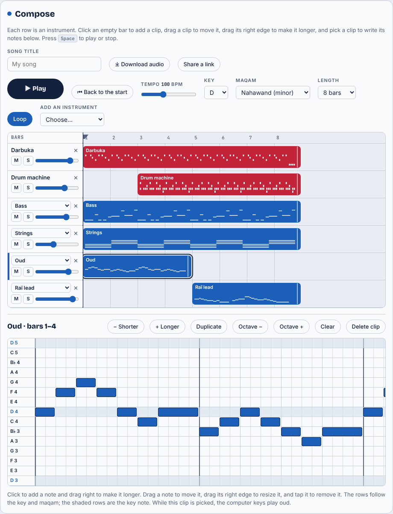
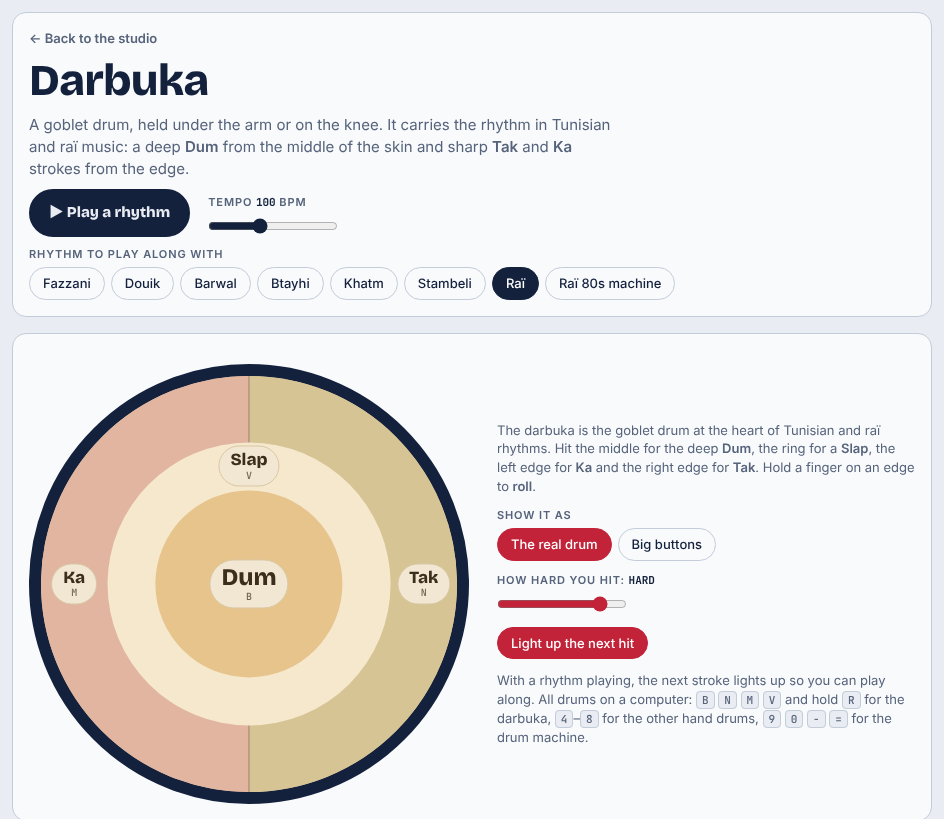
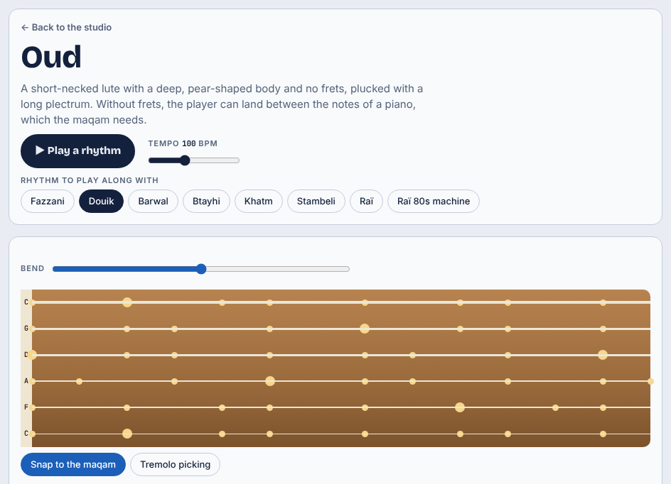

# Mousikaelektrouniya

Browser instruments for Tunisian percussion and raï music, built with the Web Audio API. There is nothing to install and no build step: each app is a single HTML file.

### ▶ [Play it now](https://nadhemkhlij.github.io/Mousikaelektrouniya/)



<table>
  <tr>
    <td></td>
    <td></td>
  </tr>
</table>

## What's inside

- **Bendir & Raï** (`bendir-rai/`), the main app. It has three parts, each with its own address:
  - **Studio** ([open](https://nadhemkhlij.github.io/Mousikaelektrouniya/bendir-rai/)): every instrument together, with four patterns you chain into a song and three melodic parts (lead, chords, bass).
  - **Compose** ([open](https://nadhemkhlij.github.io/Mousikaelektrouniya/bendir-rai/#compose)): instruments on a timeline. Each row has mute, solo and volume, and clips can be moved and stretched. Drum clips open a step grid and melody clips a note editor that follows the key and maqam. Pick a track to play its instrument, and turn on **● Record** to write what you play into the song, with an optional click track. **Undo** and **Redo** (Ctrl+Z, Ctrl+Shift+Z) cover every change.
  - **One page per instrument**, played on a screen shaped like the real thing, with a rhythm to play along with:
    [darbuka](https://nadhemkhlij.github.io/Mousikaelektrouniya/bendir-rai/#darbuka),
    [bendir](https://nadhemkhlij.github.io/Mousikaelektrouniya/bendir-rai/#bendir),
    [tar](https://nadhemkhlij.github.io/Mousikaelektrouniya/bendir-rai/#tar),
    [tbal](https://nadhemkhlij.github.io/Mousikaelektrouniya/bendir-rai/#tbal),
    [shqashiq](https://nadhemkhlij.github.io/Mousikaelektrouniya/bendir-rai/#shqashiq),
    [oud](https://nadhemkhlij.github.io/Mousikaelektrouniya/bendir-rai/#oud),
    [gasba](https://nadhemkhlij.github.io/Mousikaelektrouniya/bendir-rai/#gasba),
    [zorna](https://nadhemkhlij.github.io/Mousikaelektrouniya/bendir-rai/#zorna) and the
    [raï keyboard](https://nadhemkhlij.github.io/Mousikaelektrouniya/bendir-rai/#keyboard).
  - **Drum machine** ([open](https://nadhemkhlij.github.io/Mousikaelektrouniya/bendir-rai/#drum-machine)): for electronic music. It has ten analog-style drums with an accent row and per-drum tune and decay, a 303-style acid bass line with accents and slides, and chords (house organ, techno stab or pad). Add a DJ filter whose sweeps can be recorded into a pattern, the pump (the kick ducks the bass and chords), echo, reverb and swing, and start from a style: Techno, House, Acid house, Deep house, Minimal, Electro or Raï 80s. Four patterns (A to D) switch on the bar line while it plays, can be chained to play in turn, and copy into each other for variations. Record your taps, download 8 bars as audio, share the beat as a link, or send it all to Compose.
- **Sixteen Steps** (`sixteen-steps/`): the first prototype, a simple 16-step drum machine and synth, fully synthesized.

Melodies follow Arabic maqamat (Hijaz, Kurd, Nahawand, Bayati, Rast, Ajam), including quarter tones.

## Save and share your songs

On the Compose page:

- **⤓ Download audio** saves your song as a WAV file, ready to send or to open in other music software.
- **Share a link** makes a link that holds the whole song. Anyone who opens it hears exactly what you made, with no account needed. On a phone it opens the share menu (WhatsApp, Messages and so on). Opening someone's song never deletes your own: you can keep theirs or go back to yours.

## Install it on your phone

Bendir & Raï can be installed like an app and works without a connection once it has been opened.

- **Android (Chrome):** open the app, then tap the menu (⋮) and choose **Add to Home screen** or **Install app**.
- **iPhone (Safari):** open the app, tap **Share**, then **Add to Home Screen**.
- **Computer (Chrome or Edge):** click the install icon at the right of the address bar.

## Run it on your computer

The sounds are loaded with `fetch`, so serve the folder over HTTP instead of opening the file directly. From the repository folder:

```bash
python3 -m http.server 8000
```

Then open <http://localhost:8000/>. Edit a file, save it and reload the page; there is nothing to compile.

## Project layout

```
index.html              home page that links to everything
bendir-rai/index.html   the main app: HTML, CSS and JavaScript in one file
bendir-rai/s/*.json     sound packs (recordings, base64-encoded)
bendir-rai/manifest.webmanifest, sw.js, icons/   what makes the app installable and usable offline
og.png                  the picture shown when a link to the site is shared
docs/screenshots/       the pictures in this README
sixteen-steps/          the first prototype
tools/build_packs.py    builds the sound packs
tools/packs.json        where every sound in the packs comes from
TODO.md                 what's planned next, and the guide for recording real instruments
CONTRIBUTING.md         how the code is organised and how to work on it
```

## Working on it

Read [CONTRIBUTING.md](CONTRIBUTING.md) first. It explains how the code is organised, how to add rhythms, sounds and instruments, and how to test a change. Planned work is in [TODO.md](TODO.md).

Every push to `main` updates the live site through GitHub Pages within a minute or two, so work on a branch and open a pull request.

## How the sounds are made

- **Recorded:** the darbuka, bendir, tar, tbal, clap and shqashiq strokes, and the notes of the gasba, zorna, accordion, brass, strings, bass and raï lead. All of them are stand-ins until we record real Tunisian instruments (see [TODO.md](TODO.md)).
- **The oud:** synthesized as a plucked double string with a deep wooden body. No openly licensed oud recordings were available. The model's settings were tuned by measuring real oud recordings (how fast each note fades, how bright it is, where the body resonates) and matching the model to them. Those recordings were only a reference and are not part of this project.
- **Synthesized in the page:** the drum machine, plus the breath added to the gasba.

## Rhythms

Fazzani, Douik, Barwal, Btayhi and Khatm follow published dum/tak transcriptions. Stambeli and the raï grooves are sketches. Correct them by ear, or record your own with **Record my taps** in the studio.

## Credits

- Percussion: [Versilian Community Sample Library](https://github.com/sgossner/VCSL) (CC0, public domain): darbuka, frame drums, tambourine, finger cymbals, bass drum and claps.
- Darbuka slap: [Darbuka App](https://github.com/codewithasfend/Darbuka-App) by asfend (MIT).
- Instrument notes: FluidR3 GM soundfont by Frank Wen (CC BY 3.0), via [midi-js-soundfonts](https://github.com/gleitz/midi-js-soundfonts).

## Licence

The code is released under the [MIT licence](LICENSE). The recordings keep their own terms, listed under Credits.
